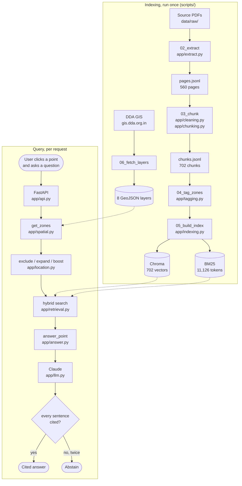

# ZoneWise

**Click a point on a map of Delhi and ask what you are allowed to build there.**

Delhi's development rules are not the same everywhere. The same question — "how much of
my plot can I build on?" — has one answer inside a Transit Oriented Development zone,
another in the High Density Corridor along UER-II, another on the Yamuna floodplain, and
another on an ordinary plot governed by the general norms. The Master Plan for Delhi 2047
runs to 505 pages of gazette notification, and **almost nobody knows which zone their own
plot is in**, so almost nobody can find the paragraph that applies to them.

ZoneWise closes that gap. It looks up the planning zones that contain your point, and
uses them to decide which clauses can possibly apply before it searches at all. Every
sentence of every answer carries a citation you can click through to the clause, with
its page number in the original PDF. When the documents do not answer the question, it
says so instead of guessing.

> **Not legal advice.** ZoneWise reports what the published documents say. Always check
> the official DDA documents before acting.

---

## What it does

- **Point-aware retrieval.** `get_zones(lat, lon)` answers from DDA's own GIS layers:
  which of the 17 planning zones, and whether the point is in a TOD zone, the High
  Density Corridor, a land pooling area or Zone O (the Yamuna floodplain).
- **Hybrid search.** Embeddings for meaning, BM25 for exact strings like `4.2.1`, `FAR`
  and `2000 sqm`, fused with reciprocal rank fusion.
- **Three location steps.** Clauses whose own policy is a zone you are *not* in are
  dropped; your zone's words are added to the query; clauses about your zone are boosted.
- **Citations on every sentence,** validated in code. A marker that names a source that
  was never supplied, or a sentence with no marker, is rejected and retried once; if the
  second attempt also fails the answer is thrown away.
- **Abstention as a first-class outcome,** with four distinct reasons. Two of them never
  reach the model at all.
- **An agent** for questions that name a place instead of giving a point: it geocodes,
  looks up the zones, searches, and may only cite clauses its own search returned.
- **A map interface** with toggleable zone overlays, zone chips for the clicked point,
  clickable citation chips and a clause reader.
- **An evaluation harness** with recall@k, MRR and bootstrap confidence intervals,
  which refuses to score questions a human has not verified.

---

## Architecture



`docs/ARCHITECTURE.md` has the same thing in detail, with a diagram per stage and the
file and function behind every step.

---

## The indexing pipeline

Run in order. Each script stands alone, is safe to re-run, and prints a summary.

```powershell
uv run python scripts/00_check_setup.py        # environment and dependencies
uv run python scripts/01_check_sources.py      # data/sources.csv against data/raw/
uv run python scripts/02_extract.py            # PDFs  -> pages.jsonl          (~2 min)
uv run python scripts/build_chapter_map.py     # which gazette pages are which chapter
uv run python scripts/03_chunk.py              # pages -> chunks.jsonl         (~25 s)
uv run python scripts/04_tag_zones.py          # add the zone tags             (~1 s)
uv run python scripts/05_build_index.py        # Chroma + BM25                 (~2.5 min)
uv run python scripts/06_fetch_layers.py       # DDA map layers, needs network (~25 s)
uv run python scripts/07_test_points.py        # six test points + preview map
uv run python scripts/08_eval_points.py        # eval/points.json
uv run python scripts/09_draft_questions.py    # eval/questions_draft.jsonl
```

`03` must run before `04`, and both before `05`. The first run of `05` downloads about
130 MB of embedding weights into `data/index/models`.

## The query pipeline

1. **`get_zones(lat, lon)`** — an STRtree lookup against the DDA polygons.
2. **Exclusion** — drop chunks whose `zone_primary` is a policy the point is not in.
   Chunks with no primary zone are never dropped, so the general norms always stay.
3. **Query expansion** — append the point's zone words, so a question containing no
   zone words can still reach the right policy.
4. **Hybrid retrieval** — dense and BM25 each return 30, fused with RRF at k = 60.
5. **Boost** — multiply the fused score of chunks about the point's zones by 1.5.
6. **Answer** — the top 6 go to Claude as numbered sources, with rules requiring a
   citation on every sentence.
7. **Validate** — check every marker and every sentence; retry once; then abstain.

---

## Data sources

Everything ZoneWise knows comes from four public documents and one GIS service. The
full list with download dates lives in `data/sources.csv`.

| Source | Publisher | Use |
| --- | --- | --- |
| [Master Plan for Delhi 2047, gazette notification](https://dda.gov.in/sites/default/files/notice/275618.pdf) | MoHUA / DDA, 20 Aug 2026 | The plan itself. English pages 640-1144 of the bilingual gazette. 548 of the 702 chunks. |
| [FAQs on MPD-2047](https://dda.gov.in/sites/default/files/notice/faqs_on_mpd-2047.pdf) | DDA | 99 question-and-answer chunks. |
| [Delhi High Court order, 8 July 2024](https://indiankanoon.org/doc/28108780/) | Delhi High Court | Yamuna floodplain encroachments. 8 chunks. |
| [GNCTD report to the NGT, OA 572/2024](https://www.greentribunal.gov.in/) | GNCTD | Floodplain demarcation. 47 chunks. |
| [DDA GIS portal](https://gis.dda.org.in/) | DDA | The zone polygons: NCT boundary, planning zones, TOD, HDC, land pooling, and three more. |

Map tiles are &copy; [OpenStreetMap](https://www.openstreetmap.org/copyright)
contributors; geocoding is by [Nominatim](https://nominatim.openstreetmap.org/).

**On the GIS layers.** DDA states no licence or terms of use anywhere on the service, so
ZoneWise does not redistribute the data. `scripts/06_fetch_layers.py` downloads it
politely (one request a second, an identifying User-Agent) into a gitignored folder, and
`data/layers/manifest.json` is committed instead so the repository still records exactly
what was fetched and when.

---

## Running it

**Requirements:** Python 3.12 and [uv](https://docs.astral.sh/uv/). Node 18+ for the
frontend. No API key is needed for search; one is needed for written answers.

```powershell
git clone <this repo>
cd delhi-plan-rag
uv sync

Copy-Item .env.example .env        # then put a real key in it when you have one
```

Put the source PDFs in `data/raw/` named `<doc_id>.pdf` (see `data/sources.csv`), then
run the indexing pipeline above.

**Start the backend:**

```powershell
uv run python scripts/serve.py
# http://localhost:8000/api/health   what is loaded
# http://localhost:8000/docs         the generated API docs
```

**The interface**, in development (hot reload, proxies `/api` to port 8000):

```powershell
cd web
npm install
npm run dev
# http://localhost:5173
```

Or build it once and let FastAPI serve everything on one port:

```powershell
cd web; npm run build; cd ..
uv run python scripts/serve.py
# http://localhost:8000
```

**Without an API key** the app runs in search-only mode: the map, the zone lookup and
clause search all work, and a question returns the clauses to read rather than a written
answer.

**Ask from the command line:**

```powershell
uv run python scripts/search.py "minimum plot size for a TOD project"
uv run python scripts/search.py "what can I build here" --lat 28.6328 --lon 77.2197
uv run python scripts/show_chunk.py MPD47_GAZETTE_EN:4.2.1:0
```

**Tests:**

```powershell
uv run pytest
```

### Configuration

Everything is configured through `.env`, and every variable is optional: the default in
`app/config.py` applies when one is unset, and a value that will not parse falls back to
that default rather than stopping the server. `.env.example` documents all of them with
their defaults; the ones worth knowing about:

| Variable | Default | What it does |
| --- | --- | --- |
| `ANTHROPIC_API_KEY` | none | Without it the app runs in search-only mode. |
| `LLM_MODEL` | `claude-haiku-5-5` | Which Anthropic model answers. Haiku because the job is short, extractive and bounded by the retrieved sources, so the smallest current model is the right one to pay for. Override to try a larger one without a code change. |
| `ZONEWISE_DEV` | off | Enables the dev-only question verification screen. Never set it in production. |
| `ABSTAIN_SIGNAL` | `dense_cosine` | Which score decides retrieval was too weak to ask the model: `dense_cosine` or `rerank_score`. |
| `ABSTAIN_THRESHOLD` | provisional | The cut-off for that signal. See [Evaluation](#evaluation). |
| `USE_RERANKER` | off | Rerank the top 20 with a cross-encoder after fusion. |
| `RATE_LIMIT_PER_DAY` | 300 | The cap that stands between a bug and an unbounded bill. |
| `CORS_ORIGINS` | `http://localhost:5173` | Comma-separated list of browser origins allowed to call the API. |

### API

| Endpoint | Key needed | What it does |
| --- | --- | --- |
| `GET /api/health` | no | what is loaded, and whether answers are possible |
| `GET /api/zones?lat=&lon=` | no | which planning zones contain a point |
| `GET /api/layers/{name}` | no | one map layer as simplified GeoJSON |
| `GET /api/chunks/{chunk_id}` | no | one clause in full |
| `POST /api/search` | no | retrieval results |
| `POST /api/ask` | **yes** | a cited answer about a point |
| `POST /api/agent` | **yes** | a cited answer about a place named in the question |

The two answering endpoints are rate limited (10 per minute per address, 300 a day
overall) and return 503 **with the retrieved clauses included** when no key is set.

---

## Evaluation

**Results pending a verified question set.** No retrieval numbers are published here
yet, and that is deliberate.

The harness is built and runs: four configurations (dense, BM25, hybrid,
hybrid+location) scored on recall@1/3/5 and MRR, with bootstrap 95% confidence intervals
and a paired comparison of hybrid+location against hybrid. There is also a sweep that
asks whether the top retrieval score alone can decide when to refuse a question.

What is missing is questions a person has checked. The 60 in
`eval/questions_draft.jsonl` were drafted by Claude Code from the same chunks the
retriever searches, so scoring against them measures how well the retriever agrees with
its own author. Two guards are enforced in code — no run of four or more consecutive
words copied from an expected chunk, and no location question naming its own zone — but
guards are not verification. `eval/run_eval.py` therefore scores only questions marked
`verified: true`, and a dry run is written to a file prefixed `DRYRUN_` with a banner
saying the numbers are not results.

`eval/README.md` is the step-by-step procedure for verifying a question, and explains
what each metric means in plain English.

---

## Limitations

- **No published evaluation numbers yet**, for the reason above.
- **Six DDA explainer PDFs are not indexed.** They are scanned images with no text
  layer; OCR is a separate decision that has not been taken.
- **One NGT order could not be downloaded** — the source URL 404s. It is listed in
  `data/sources.csv` with `include=no` so the gap is visible.
- **Planning zone A is missing from DDA's layer.** Their zone layer ships 16 polygons
  where the plan's own section 1.7.2 lists 17; the absent one is the Walled City. A
  point there returns no zone letter rather than a guessed one.
- **Zone boundaries are approximate.** They come from a web GIS service, not from a
  survey, and should never be used to decide where a legal boundary runs.
- **Zone O can boost but never exclude.** MPD-2047 has no Zone O policy section to point
  at, so floodplain questions work through mentions only (D-024, D-037).
- **English only.** The gazette's Hindi half is skipped.
- **The abstention threshold is a placeholder** (D-042) until the evaluation can choose
  it.
- **Retrieval is evaluated, answers are not.** Whether a cited clause really supports
  the sentence citing it is not yet measured.

---

## Project structure

```
app/            the Python package: config, llm, extract, cleaning, chunking, tagging,
                indexing, retrieval, location, spatial, geocode, answer, agent, api
scripts/        numbered pipeline scripts, run in order, plus search.py and show_chunk.py
data/
  sources.csv       every document, with URL, date and authority rank
  raw/              source PDFs                                   (not committed)
  processed/        pages.jsonl, chunks.jsonl, reports            (not committed)
  index/            Chroma, BM25, model weights, geocode cache    (not committed)
  layers/           manifest.json (committed); dda/ holds the GeoJSON (not committed)
  logs/             requests.jsonl                                (not committed)
  chapter_map.json, zone_sections.json, test_points.json          (committed)
eval/           points.json, the drafted questions, metrics.py, run_eval.py, results/
reports/        run reports written for a human to read
docs/           ARCHITECTURE.md, DATA.md, LEARNING_NOTES.md
web/            the React + Vite frontend
tests/          204 pytest tests
DECISIONS.md    every design choice, numbered, with the alternatives rejected
```

## Tech stack

| Layer | Choice | Why |
| --- | --- | --- |
| Language | Python 3.12, managed with uv | one tool for the version and the dependencies |
| PDF | PyMuPDF | fast, and reads tables well enough to keep their shape |
| Embeddings | fastembed, BAAI/bge-small-en-v1.5 | 384 dimensions, runs on a laptop CPU, no API |
| Keyword search | rank_bm25 | exact matching on clause numbers and figures |
| Vector store | Chroma, local and persistent | no server to run |
| Fusion | reciprocal rank fusion, k = 60 | combines rank orders, which are comparable; scores are not |
| Geo | GeoPandas, Shapely, pyproj | areas in EPSG:32643, stored as EPSG:4326 |
| LLM | Anthropic API, through one wrapper | one door, so a fake client can stand in for tests |
| API | FastAPI | typed request bodies and generated docs |
| Frontend | React + Vite + react-leaflet | plain JavaScript, six dependencies, no UI framework |
| Tests | pytest | 204, all with fixtures written in the test |

No RAG or agent framework is used. The chunking, the hybrid search, the fusion, the
citation validation and the agent loop are all written here, so every step is visible
and testable. See `DECISIONS.md` D-003.
